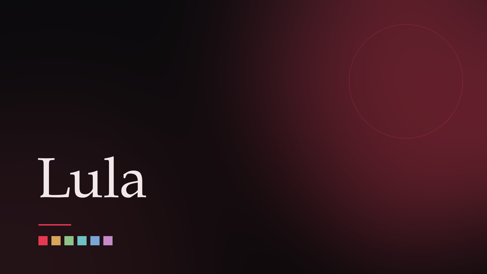

# Lula for Omarchy

A dark-red Omarchy theme. Near-black wine-tinted surfaces, a red accent
used where it matters — focused borders, active bar elements, selections —
and warm, highly legible text.

Its light sibling, **Lula Light** (warm paper, deep wine ink, the same
red family), lives at
[PedroAugustoOK/omarchy-lula-light-theme](https://github.com/PedroAugustoOK/omarchy-lula-light-theme).



## Palette

| Role | Color | Hex |
|---|---|---|
| Primary background | Near black | `#0B0A0C` |
| Recessed | Black | `#080708` / `#050404` |
| Raised surface | Dark wine | `#21171C` |
| Accent / Red | Wine red | `#E63950` |
| Intense red | Bright red | `#FF5C74` |
| Deep wine | Wine | `#761C30` (borders) |
| Selection | Dark wine | `#4A1E2A` |
| Primary text | Warm white | `#F2E8EB` |
| Secondary text | Muted rose | `#B7A2A9` |
| Muted | Grey rose | `#8A757D` |

Full ANSI set (all ≥ 4.5:1 vs background except brown, which is decorative):

- `red #E63950`, `yellow #D9A45B`, `orange #D97352`, `green #8FC38A`
- `cyan #6EC2C4`, `blue #7AA5D6`, `magenta #C48AC9`, `brown #A67C64`
- Bright variants are 20%+ toward white and visibly distinct.

Contrast (measured): foreground/background **16.5:1**, secondary **8.2:1**,
accent/background **4.8:1**, selection pairing **14.5:1**.

Window borders use a red gradient:

```toml
hyprland_active_border = "rgba(E63950ee) rgba(761C30ee) 45deg"
hyprland_inactive_border = "rgba(4a1e2aaa)"
```

## Wallpapers

Three 2560×1440 abstract wallpapers in `backgrounds/` (cycle with
`Super + Ctrl + Space`). They follow the quiet, soft-focus language of
[Veredas](https://github.com/PedroAugustoOK/omarchy-veredas-theme): no
imagery, just slow washes of wine and near-black.

| Wallpaper | Description |
|---|---|
|  `001-lula-ember.png` | A diagonal ember glow dissolving into near-black |
|  `002-lula-velvet.png` | A soft central bloom of deep wine, barely lit |
|  `003-lula-dusk.png` | Warm ember light low at the foot of the frame |

PNG, 145–180 KB each. Original abstract artwork generated
programmatically with ImageMagick; no third-party imagery.

## Compatibility

- Omarchy **4.x** (tested on `4.0.4-1` and `4.0.5-1`). Requires the
  `colors.toml` theme system with `mode`, template expansion and
  `hypr_gradient` support.
- Everything is derived from `colors.toml` through Omarchy's built-in
  templates: Hyprland borders, shell (bar, menus, launcher, notifications,
  OSD, lock), Alacritty/Foot/Ghostty/Kitty, btop, Chromium, Neovim (aether),
  Helix, VS Code theme, Obsidian, Claude/Pi/Hermes/T3Code, keyboard RGB.
- The repo ships **no** `.lua`, terminal configs or `vscode.json`, since
  those are dropped for git-installed themes and regenerated locally.
  The theme looks correct from `colors.toml` alone.
- Icons: `Yaru-red`. Keyboard backlight: red `e63950`.

## Installation

```bash
omarchy theme install https://github.com/PedroAugustoOK/omarchy-lula-theme.git
```

This clones to `~/.config/omarchy/themes/lula` and applies it immediately.
(Menu path: `Install > Style > Theme`.)

## Activation

```bash
omarchy theme list       # confirm `lula` is listed
omarchy theme set lula
omarchy theme current    # should print `Lula`
omarchy theme bg next    # cycle the three wallpapers
```

Preview the palette without applying:

```bash
omarchy dev theme-preview lula
```

## Update and removal

```bash
omarchy theme update          # pull latest for all git-installed themes
omarchy theme refresh         # re-apply the current theme after an Omarchy upgrade
omarchy theme remove lula      # delete the local clone
```

After `omarchy update` brings new Omarchy versions, run
`omarchy theme refresh` once so your staged configs are generated with the
current templates.

To restore your previous theme: `omarchy theme set "<name>"`
(see `omarchy theme list`).

## Optional extras (machine-local, not part of the theme)

- **Plymouth boot screen** — apply Lula to the boot/login screen:

  ```bash
  omarchy-plymouth-set-by-theme lula   # uses unlock.png + palette (asks for sudo)
  omarchy plymouth preview '#0B0A0C' '#F2E8EB' ~/.config/omarchy/themes/lula/unlock.png /tmp/lula-boot.png
  ```

  The preview command leaves an `imv` window open showing the render — close
  it to finish. Reset with `omarchy plymouth reset` or pick another theme's
  boot screen under `Style > Unlock`.
- **OWE wallpaper engine** (`omarchy pkg add owe`) can play animated
  backgrounds/intros from themes. Lula ships static wallpapers only;
  see `RESEARCH.md §11` for the intro-vs-OWE status.

## Repository structure

```text
omarchy-lula-theme/
├── colors.toml          # the palette — the only required file
├── backgrounds/         # 3 abstract wallpapers
├── icons.theme          # Yaru-red
├── keyboard.rgb         # e63950
├── preview.png          # 1800×1012 theme-picker artwork
├── unlock.png           # transparent lock-screen art
├── preview-unlock.png   # 1920×1080 lock preview (Style > Unlock)
├── scripts/             # make-preview.sh, generates preview.png
├── README.md
├── RESEARCH.md          # how Omarchy theming was verified
├── LICENSE
└── .gitignore
```

## Credits and license

- Theme, palette and all wallpapers: original work for this repository,
  generated programmatically with ImageMagick. No third-party assets.
- Palette: MIT (see `LICENSE`; covers `colors.toml` and config files).
- Wallpapers/previews: same MIT license (original works, no attribution
  required).
- Built for [Omarchy](https://omarchy.org) (`basecamp/omarchy`).
  Icon set names belong to Yaru; font rendering in previews uses system fonts.
